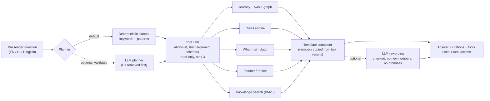

# AI architecture (next round)

**Short version:** the rules engine decides; AI (if switched on) only helps to *understand* the question and to
*reword* the answer. Every number, rule, deadline and refund comes from deterministic code that is tested.
With no AI key at all, every feature still works.

## 1. Where AI is used, and where it is not

| Job | Who does it | AI allowed? |
| --- | --- | --- |
| Detect delay / broken connection / waitlist after chart | `detect/detector.py`, `graph/journey_graph.py` | No |
| Refund and TDR amounts, eligibility, deadlines | `rules/` (versioned YAML, money in paise) | **No — never** |
| Alternative trains and ranking | CSA route search + ranker | No |
| What-If outcomes | `whatif` (hypothetical events, never stored) | No |
| Understanding a free-text question | Deterministic planner; optional LLM planner | Optional, validated |
| Wording the answer | Templates; optional LLM rewording | Optional, validated |
| Answering a general rules question | Extractive answer from cited documents | Optional rewording only |

## 2. Journey Copilot (`backend/app/copilot/`)

- **Tools** (`tools.py`): `get_journey`, `get_train_status`, `detect_connection_risk`, `calculate_transfer_buffer`,
  `evaluate_railway_rules`, `get_applicable_deadlines`, `simulate_journey_options`, `rank_recovery_plans`,
  `get_cached_journey_state`, `search_railway_knowledge`, `get_family_options`.
  - All are **read-only**. There is no tool to book, cancel, pay or file a TDR.
  - Each tool has a Pydantic argument model with `extra="forbid"` and number ranges (e.g. wait 5–720 min).
    Unknown tools → `TOOL_NOT_ALLOWED`; bad arguments → `INVALID_ARGUMENTS`.
  - The journey is fixed by the server from the URL. The model cannot choose another passenger's journey.
- **Planner** (`copilot.py`): the deterministic planner understands natural-language What-If
  ("what if I wait 45 minutes", "if the delay grows by an hour", "should I wait or take another route",
  "explain my refund rights in simple Hindi"). Out-of-range numbers make it ask back instead of guessing.
  The optional LLM planner must return JSON that passes the same validation; otherwise the deterministic plan is used.
- **Answers**: templates fill in values straight from tool results. Optional LLM rewording is rejected if it adds
  a number that is not in the draft or the facts, drops a ₹ amount, or contains promise words ("guaranteed", "definitely").
- **Stale data**: if live data is out of date the Copilot refuses to advise and points to 139 / NTES / RailOne.
- **Output** always includes: `answer_source` (TEMPLATES / KNOWLEDGE_EXTRACTIVE / LLM_PHRASED), citations,
  the tool calls made, next actions (links inside the app), `no_reliable_source`, `planner`.

## 3. Retrieval with citations (`backend/app/knowledge/`)

- **Corpus**: generated from `rulesets.yaml` (so rule text and engine can't disagree) plus three short markdown
  documents (help channels, data trust, TDR basics). Today: 11 documents, 21 chunks.
- **Provenance per chunk**: source URL, publisher, version, `effective_from` / `effective_to`, `applies_to`,
  legal status (NOTIFIED / ANNOUNCED / NEEDS_VERIFICATION), unresolved conditions.
- **Ingestion filter**: chunks that look like instructions to an AI ("ignore previous instructions" …) are dropped.
  Retrieved text is always treated as data, never as instructions.
- **Retriever**: BM25 with English/Hindi/Hinglish synonyms, behind a `Retriever` protocol and an `as_of` date filter
  (expired rules are not used for today). *Why not embeddings?* No embedding model could be downloaded in this
  build environment; the protocol lets a vector retriever be added later without touching callers.
- **Grounded answer**: extractive (quotes the best sentences), cites only the passages it used, and returns
  "No reliable source found" below a score threshold instead of guessing.

## 4. Safety checklist (each item has a test)

| Risk | Control | Test |
| --- | --- | --- |
| LLM invents a refund | Amounts only from rules engine; phrase check | `test_llm_phrasing_cannot_add_numbers_or_promises`, E2E 19 |
| Prompt injection in the question | Instructions ignored; deterministic intent; validated plans | `test_copilot_prompt_injection_by_passenger`, `test_llm_planner_rejected_when_unsafe`, E2E 19 |
| Prompt injection in documents | Ingestion filter; documents treated as data | `test_injection_text_is_dropped_at_ingestion` |
| Unknown tool / bad arguments | Allow-list + strict schemas | `test_tool_allowlist_is_read_only_and_validated`, `test_hypothetical_tools_never_store_events` |
| PNR / phone / email sent to an LLM | `redact()` before any LLM call (message, history, facts) | `test_no_raw_pnr_or_names_sent_to_llm`, `test_no_pnr_phone_or_email_reaches_the_llm` |
| Stale data shown as live | Freshness on every fact; Copilot refuses on stale data | `test_copilot_stale_data_refuses`, `test_recovery_stale_gives_no_advice`, E2E 6 |
| Expired rule used | `effective_to` + `as_of` filter | `test_retrieval_english_hindi_hinglish_and_dates` |

## 5. What is honestly *not* here

- No fine-tuned or trained ML model, and **no ML confidence scores**. "Confidence" labels are rule-based and say so.
- No real-time IRCTC/NTES data (needs authorised access). Providers have `Official*` stubs that raise
  `ProviderNotConfigured` rather than pretending.
- The optional LLM path is tested with a fake LLM, not against a paid model in this environment.
