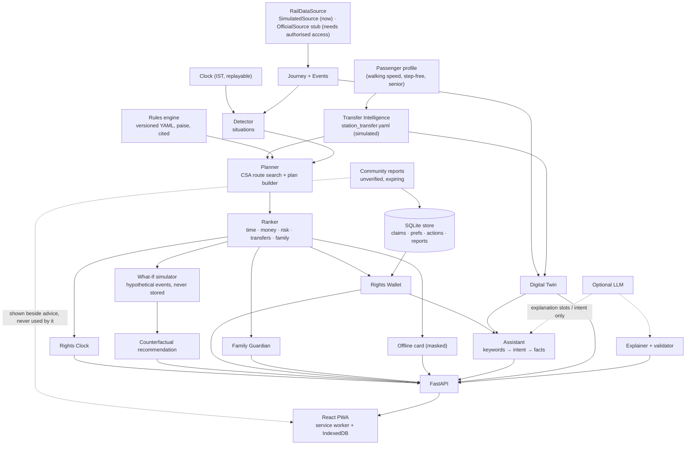
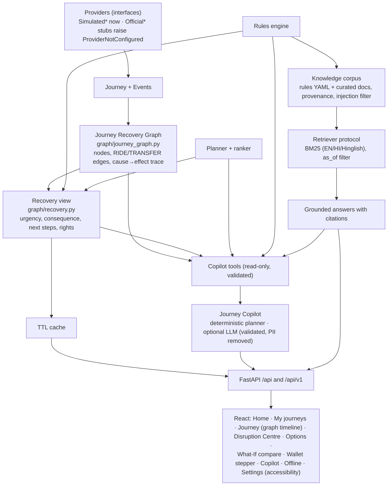
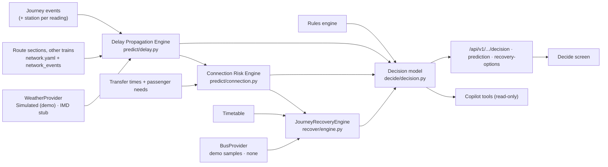

# Architecture

One deterministic core, many views. Every new feature reads the same journey, events and rules,
so the passenger never sees two different answers for the same question.

## Design rules (kept from the original build, enforced by tests)

- **Money and deadlines are deterministic.** Only the rules engine computes them. Every result carries the rule id,
  version, categories, effective date, legal status, source and unresolved conditions.
- **AI is optional.** The LLM may fill explanation templates (slots only, validated) or pick an assistant intent.
  It never produces numbers, rules, dates or advice. With no key, everything works.
- **No business logic in React.** Screens display backend results; the only client logic is formatting,
  the offline store and the browser speech APIs.
- **Data honesty.** All railway data is simulated and labelled. Transfer times are simulated estimates. Offline
  cards say "snapshot, not live" with the time they were made. Community reports are unverified and cannot change
  recommendations (a test compares assessments with and without reports).
- **Privacy.** No names: family members are labels. The offline card masks the PNR. Community notes reject phone
  numbers and emails; reporters are stored only as hashes. The only device storage is the masked card (IndexedDB)
  and the language setting.

## Feature → module map

| Feature | Backend | Frontend |
| --- | --- | --- |
| Digital Twin | `twin/twin.py` | `components/TwinPanel.tsx` (Overview) |
| What-If | `whatif/simulator.py` | `screens/WhatIfScreen.tsx` |
| Family Guardian | `family/family.py`, `data/groups.json`, scenarios 5–6 | `screens/FamilyScreen.tsx` |
| Offline Guardian | `offline/card.py` | `screens/OfflineCardScreen.tsx`, `offlineStore.ts`, `public/sw.js` |
| Transfer Intelligence | `plan/transfer.py`, `data/station_transfer.yaml`, `plan/csa.py` (per-station transfer rule) | badges in Options, Twin |
| Rights Wallet | `wallet/wallet.py`, `store.py` | `screens/WalletScreen.tsx` |
| Assistant | `assistant/assistant.py` | `screens/AssistantScreen.tsx` (Web Speech API) |
| Resilience | `insights/resilience.py` | `screens/ResilienceScreen.tsx` |
| Counterfactuals | `plan/counterfactual.py` | `components/RecommendationBox.tsx` |
| Community | `community/reports.py` | `screens/CommunityScreen.tsx` |

## Security and deployment design (after the final audit)

- **Static files:** the server only serves files that are really inside `frontend/dist`; any `../` path gets the app page.
- **Rate limit:** per caller address. In Docker, uvicorn runs with `--proxy-headers`, so behind Render's proxy each user is counted separately. Quiet addresses are forgotten.
- **Presenter protection:** optional `DEMO_TOKEN` (set in the hosting dashboard). The presenter page sends it as `X-Demo-Token`; passenger endpoints never need it.
- **Headers:** `nosniff`, `no-referrer`, `X-Frame-Options: DENY`, and `Permissions-Policy` allowing only the microphone (for voice).
- **CORS:** not needed in production (one origin); only the local dev origin is allowed by default.
- **Community reports:** one caller = one reporter (hashed address); client headers are ignored.
- **Honest money labels:** if an amount depends on a rule with legal status ANNOUNCED, the UI shows "Estimate: rule not yet confirmed" (never "Automatic"), and the assistant adds a warning.

## Bugs found and fixed

See `docs/TEST_REPORT.md` for the full list with the test that guards each fix.

## Next round additions

Still one modular monolith. The new parts read the same journey, events and rules as everything else.

| New module | Job |
| --- | --- |
| `app/graph/journey_graph.py` | Builds the connected-journey graph from events every time (no hidden state) and explains how a delay spreads |
| `app/graph/recovery.py` | One "what now?" view: urgency, consequence, next steps, rights |
| `app/knowledge/` | Corpus, retriever, grounded answers (see `docs/AI_ARCHITECTURE.md`) |
| `app/copilot/` | Tools + planner + composer (see `docs/AI_ARCHITECTURE.md`) |
| `app/providers/` | Data-source interfaces so official feeds can replace simulated ones |
| `app/core/cache.py` | Small in-process TTL cache (no Redis needed at this scale) |
| `frontend/src/screens/{Home,MyJourneys,Disruption,Copilot,Settings}Screen.tsx` | New screens; old screens and routes kept |

Scaling plan, proportionate: one process handles the demo easily; next steps would be a real database
(`STORE_PATH` → Postgres), more instances behind a load balancer (the app keeps no per-user state in memory except
the short cache), and provider-side caching of live status. No Kafka, Kubernetes or microservices are needed for this.

## Decision upgrade: PREDICT → DECIDE → RECOVER

Still one modular monolith. No new services, queues or databases. Every new engine is a plain Python module with
its own tests, and every external data source is behind an interface that refuses (`ProviderNotConfigured`) instead of pretending.
