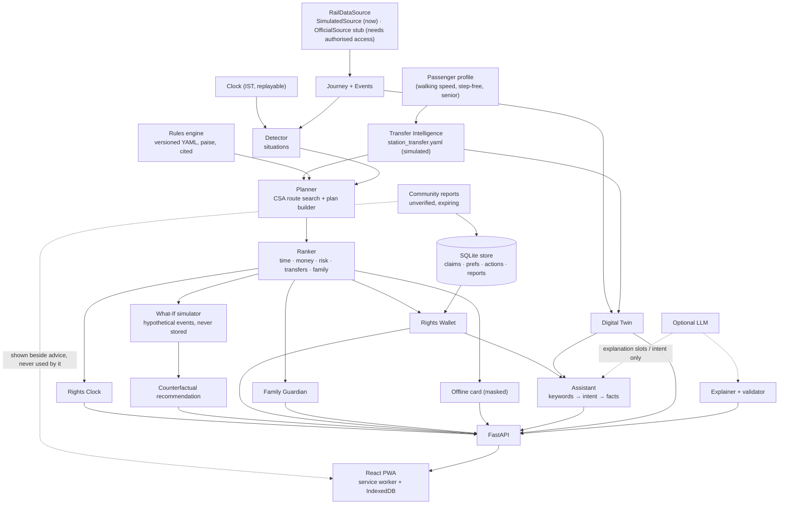

# Architecture

One deterministic core, many views. Every new feature reads the same journey, events and rules,
so the passenger never sees two different answers for the same question.

## Design rules (kept from the original build, enforced by tests)

- **Money and deadlines are deterministic.** Only the rules engine computes them. Every result carries the rule id,
  version, categories, effective date, legal status, source and unresolved conditions.
- **AI is optional.** The LLM may fill explanation templates (slots only, validated) or pick an assistant intent.
  It never produces numbers, rules, dates or advice. With no key, everything works.
- **No business logic in React.** Screens display backend results; the only client logic is formatting,
  the offline store and the browser speech APIs.
- **Data honesty.** All railway data is simulated and labelled. Transfer times are simulated estimates. Offline
  cards say "snapshot, not live" with the time they were made. Community reports are unverified and cannot change
  recommendations (a test compares assessments with and without reports).
- **Privacy.** No names: family members are labels. The offline card masks the PNR. Community notes reject phone
  numbers and emails; reporters are stored only as hashes. The only device storage is the masked card (IndexedDB)
  and the language setting.

## Feature → module map

| Feature | Backend | Frontend |
| --- | --- | --- |
| Digital Twin | `twin/twin.py` | `components/TwinPanel.tsx` (Overview) |
| What-If | `whatif/simulator.py` | `screens/WhatIfScreen.tsx` |
| Family Guardian | `family/family.py`, `data/groups.json`, scenarios 5–6 | `screens/FamilyScreen.tsx` |
| Offline Guardian | `offline/card.py` | `screens/OfflineCardScreen.tsx`, `offlineStore.ts`, `public/sw.js` |
| Transfer Intelligence | `plan/transfer.py`, `data/station_transfer.yaml`, `plan/csa.py` (per-station transfer rule) | badges in Options, Twin |
| Rights Wallet | `wallet/wallet.py`, `store.py` | `screens/WalletScreen.tsx` |
| Assistant | `assistant/assistant.py` | `screens/AssistantScreen.tsx` (Web Speech API) |
| Resilience | `insights/resilience.py` | `screens/ResilienceScreen.tsx` |
| Counterfactuals | `plan/counterfactual.py` | `components/RecommendationBox.tsx` |
| Community | `community/reports.py` | `screens/CommunityScreen.tsx` |

## Bug found and fixed during the upgrade

A cancellation known days ahead was hidden behind "not watching yet" because the detector only started
watching 12 hours before departure. Known cancellations are now reported immediately
(`detect/detector.py`, test `test_cancellation_known_days_early_is_shown_immediately`).
